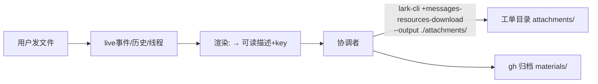
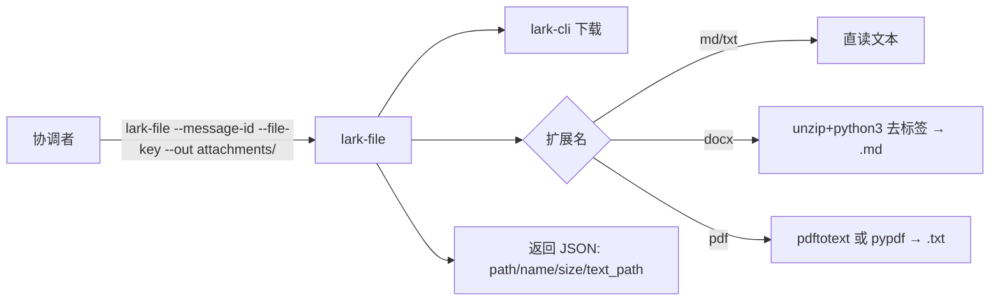

# 研究：飞书文件附件进 DSH 的五种方案

- 日期：2026-11-23
- 状态：研究结论 + 方案选项（待你选择）
- 结论先行：**技术路径全部可行，差别在"下载谁做、转换谁做、谁读得到"**；建议先做 A + B 的 docx 分支，PDF 与"自动识别"再按需加。

---

## 一、研究结论速览（均已实证）

| # | 事实 | 证据 |
|---|---|---|
| 1 | `lark-cli` **本来就能下载文件**：`im +messages-resources-download --message-id om_x --file-key file_v3_x --type file --output ./x.md`；返回 `data.saved_path` / `data.size_bytes`；`--output` 拒绝绝对路径与 `..` | 容器内 `--help` |
| 2 | `lark-cli` 还有**一键批量下载**：`+messages-mget` / `+threads-messages-list` / `+chat-messages-list` 加 `--download-resources`，附件自动落到当前目录 `./lark-im-resources/`，并给每条消息加 `resources:[{message_id,key,type,local_path,size_bytes,error?}]`；去重、并发 3、单个失败不影响其他、**不需要额外权限** | `lark-im-message-enrichment.md` |
| 3 | 文件消息的渲染形态是 `<file key="file_v3_xxx" name="需求.md"/>` | 二进制内格式串 `<file key="%s" name="%s"/>` |
| 4 | **两条读取路径形状不同**：live 事件 `content` 是"预渲染人类可读文本"；只读命令 `content` 可能是原始 JSON。live 事件字段是 **`message_type`**（不是 `msg_type`），且**不含 file_key** | `event schema im.message.receive_v1` |
| 5 | 现状代码只吃文本+图片：`admissionImageKeys` 只匹配 `img_...`；`historyText()` 对纯 JSON 内容回退成 `JSON.stringify` → **模型看到的是一段 JSON**（与你观察一致） | `feishu-image.ts:12`、`feishu-trigger.ts:67-73` |
| 6 | 镜像里**没有转换器**：pandoc ✗、pdftotext ✗、libreoffice ✗；有 python3、node、unzip | 容器内探测 |
| 7 | docx 文本可**零依赖**提取（docx 是 zip，`unzip -p x.docx word/document.xml` + 去标签）；**PDF 不行**，必须装依赖（poppler-utils 或 `pip install pypdf`） | 同上 |
| 8 | 飞书侧还有更强的通道：`docs +fetch --doc-format markdown`（云文档直读）、`drive +import`（本地 Word/Markdown→云文档）、`lark-markdown`、`lark-wiki`、`lark-sheets` | `lark-doc` / `lark-drive` skill |
| 9 | 但**机器人身份缺 docx 权限**：`docs +fetch` 实测报 `app_scope_not_applied: 需要 docx:document, docx:document:readonly`；且本部署**只有 bot 身份**（user 身份 missing），无法 `--as user` | 容器内实测 |
| 10 | **工作目录陷阱**：`commands.lark(args)` 不传 cwd 时用进程 CWD（容器内 `/opt/...`），不是工单目录。所以"source 侧顺手下载"会把文件落到共享目录；**worker 侧执行**才会落在工单目录 | `src/infra/commands.ts:103-106` |

> 这 10 条里，第 4、10 条是最容易踩的坑：任何方案都必须**同时兼容"标记形态"与"JSON 形态"**，并明确**由谁的 CWD 落盘**。

---

## 二、五种方案

### 方案 A —「最小可行：只修渲染，下载交给 CLI」
**适用**：想让 `.md/.txt/.csv/.json` 这类**纯文本附件**立刻能用。


- **改**：`feishu-trigger.ts`（识别 `file_v3_*` 与 `<file .../>`，渲染成"📎 附件：名字 + key + 下载命令"）；`feishu-read.ts` 视图复用；`SKILL.md` 加一段下载指引。
- **不改**：下载、转换、限额都交给 CLI 自己（官方已测）。
- **代码量**：~100 行。**依赖**：0。
- **能力**：纯文本类附件 ✅；docx/pdf ❌（二进制读不懂）。
- **风险**：低。**体验**：worker 多跑一条命令。

---

### 方案 B —「工作区助手 `lark-file`：下载+限额+转换集中一处」
**适用**：要 docx，且要可控的限额/白名单/审计。


- **改**：新增 `lark-file`（sh/node 脚本）+ `WORKER_COMMANDS` 加一项 + 镜像里装 `poppler-utils`（仅 PDF 需要）+ skill 一段。
- **代码量**：~300 行。**依赖**：docx 零依赖；PDF 需 poppler（~5MB）或 pypdf。
- **能力**：md/txt/docx ✅；pdf ✅（装依赖后）；全链路限额/白名单/命名安全/审计 ✅。
- **风险**：中低（多一个自维护件）。**体验**：worker 一条命令拿"文本+原件"。

---

### 方案 C —「Source 层预取 + 评估期就能读」
**适用**：追求"用户只发文件+@机器人，机器人当场看懂并出计划"。

```mermaid
flowchart LR
  U[用户发文件+@] --> S[Source:识别+预取+转文本]
  S --> T[触发文本 = 说明 + 附件摘要/正文节选]
  T --> A[Assessment 直接判定]
  A --> P[建计划]
```
- **改**：`ThreadContext` 增 `files/file`（类比现有 `images/image`）+ `feishu-read.ts` 实现 + 评估上下文注入 + 转换器。
- **代码量**：~400 行。**依赖**：同 B。
- **能力**：判定阶段即读附件 ✅（体验最佳）。
- **风险**：**最高**（动评估链路、上下文膨胀、成本/延迟上升、回归面大）。
- **注**：预取必须显式指定 cwd（见事实 10），否则落到共享目录。

---

### 方案 D —「云转换：用飞书自己把 docx/pdf 转成 markdown」
**适用**：不想在镜像里装任何转换器，且能接受云端副产物。


- **改**：封装 2–3 条 CLI 调用 + skill 指引。~120 行。
- **依赖**：**控制台给应用加权限**（`docx:document:readonly` + drive 写）；会产生云端文件（留痕/占空间）。
- **能力**：docx/pdf/pptx 都能转，格式保真度高，零本地依赖。
- **风险**：中（权限、副作用、两次往返、文件多时慢）。

---

### 方案 E —「换通道：需求写在飞书云文档，发链接」
**适用**：长篇需求；也最贴合飞书用户习惯。

```mermaid
flowchart LR
  U[写飞书文档] --> M[群里发链接+@机器人]
  M --> S[Source 识别文档链接]
  S --> D[docs +fetch --doc-format markdown]
  D --> W[协调者归档 materials/]
```
- **改**：识别消息里的 docx/wiki 链接 + fetch 封装。~150 行。
- **依赖**：**控制台给应用加 `docx:document:readonly`**（实测现在没有）+ 文档需对应用可见。
- **能力**：富文本、表格、版本、协作 ✅；无需处理二进制。
- **风险**：中低。**代价**：改变用户习惯（写文档而非传文件）；不覆盖"已有本地 docx"的场景。

---

## 三、对比矩阵

| 维度 | A 最小可行 | B 助手封装 | C 评估期读 | D 云转换 | E 文档链接 |
|---|---|---|---|---|---|
| 下载谁做 | CLI | 自研封装调 CLI | Source | CLI(drive) | CLI(docs) |
| 转换谁做 | 不做 | 本地(docx 零依赖) | 本地 | 飞书服务 | 飞书服务 |
| .md/.txt | ✅ | ✅ | ✅ | ✅ | ✅ |
| .docx | ❌ | ✅ 零依赖 | ✅ | ✅ | ✅ |
| .pdf | ❌ | ✅ 需装 poppler | ✅ | ✅ | ✅ |
| .pptx/.xlsx | ❌ | ❌ | ❌ | ✅ | ✅ |
| 代码量 | ~100 行 | ~300 行 | ~400 行 | ~120 行 | ~150 行 |
| 镜像改动 | 无 | +脚本 +poppler | 同 B | 无 | 无 |
| 控制台权限 | 无 | 无 | 无 | docx read + drive 写 | docx read |
| 用户操作 | 传文件 | 传文件 | 传文件 | 传文件 | 写文档发链接 |
| 判定阶段可读 | ❌ | ❌ | ✅ | ❌ | ✅ |
| 落地风险 | 低 | 中低 | **高** | 中 | 中低 |
| 建议工期 | 0.5–1 天 | 1.5–2 天 | 3–4 天 | 1 天 | 1 天 |

---

## 四、跨方案的三个硬约束（不管选哪个都要处理）
1. **双形态兼容**：live 事件给"预渲染文本+`message_type`"，只读命令给"标记/JSON+`msg_type`"。渲染函数必须两者都吃：`file_v3_*`（JSON 的 `file_key` 或标记的 `key=`）。
2. **落盘 CWD**：谁执行谁落盘。Source 侧下载必须显式 `cwd`；worker 侧天然在工单目录。
3. **内容不可信**：附件正文视为**数据**，不能当指令执行；协调者仍只做归档/计划，不执行需求里的"命令"。

---

## 五、我的建议（分阶段，不一次性上大改）
1. **先做 A**（0.5–1 天）：立刻让纯文本附件可用，把"必须手贴文本"的痛点消掉，且几乎零风险。
2. **紧接着 B 的 docx 分支**（0.5 天）：docx 零依赖提取，覆盖最常见的长文档。
3. **PDF 按需**：要么 B 里加 `poppler-utils`，要么走 D（云转换）——**不建议**为 PDF 直接上 C。
4. **C 放最后**：等 A+B 跑顺、确认"附件即需求"是高频场景再上，避免一开始就撬动评估链路。
5. **E 可与任一方案并行**作为推荐工作方式（长篇需求写云文档），但要先加 `docx:document:readonly`。

---

## 六、需要你拍板
1. **首要目标**是哪一类附件？（决定要不要 PDF/PPTX）
   - (a) 只要 `.md/.txt`（选 A）
   - (b) 含 `.docx`（A+B）
   - (c) 还要 `.pdf/.pptx/.xlsx`（B 装 poppler 或 D）
2. **是否接受在镜像里装转换器**（poppler ~5MB / pypdf）？还是宁可走飞书云端转换（D，需加权限、有云端留痕）？
3. **要不要"发文件即自动建计划"**（C）？还是维持"协调者下载后归档、按需推进"？前者体验好但改动与成本最大。
4. **是否愿意在飞书开放平台给应用加 `docx:document:readonly`**（E/D 的前提）？
5. 归档策略：只提交**整理后的 `.md`**，还是**原件+整理稿都进仓库**？

---

## 附：可直接复用的命令（实证可用）
```bash
# 单个附件下载（worker 在工单目录执行）
lark-cli im +messages-resources-download --message-id om_xxx --file-key file_v3_xxx --type file --output ./attachments/需求.md

# 批量：读消息顺带把附件拉到 ./lark-im-resources/ 并返回 resources 数组
lark-cli im +messages-mget --message-ids om_xxx --download-resources --no-reactions

# docx 零依赖提取正文（镜像已有 unzip + python3）
unzip -p 需求.docx word/document.xml | python3 -c "import sys,re;t=sys.stdin.read();print(re.sub(r'<[^>]+>','',t.replace('</w:p>','\n')))"

# 云文档直读（需先加 docx:document:readonly 权限）
lark-cli docs +fetch --doc '<docx 或 wiki URL>' --doc-format markdown
```
